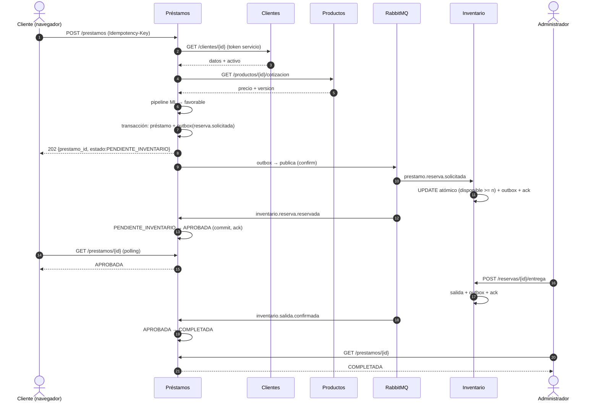
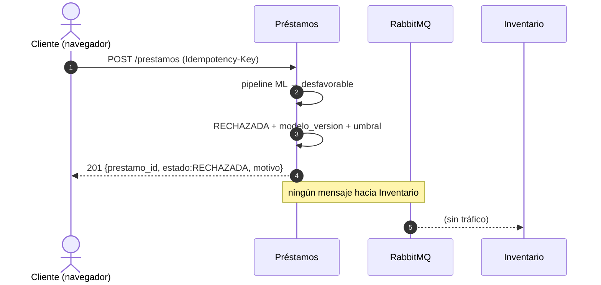
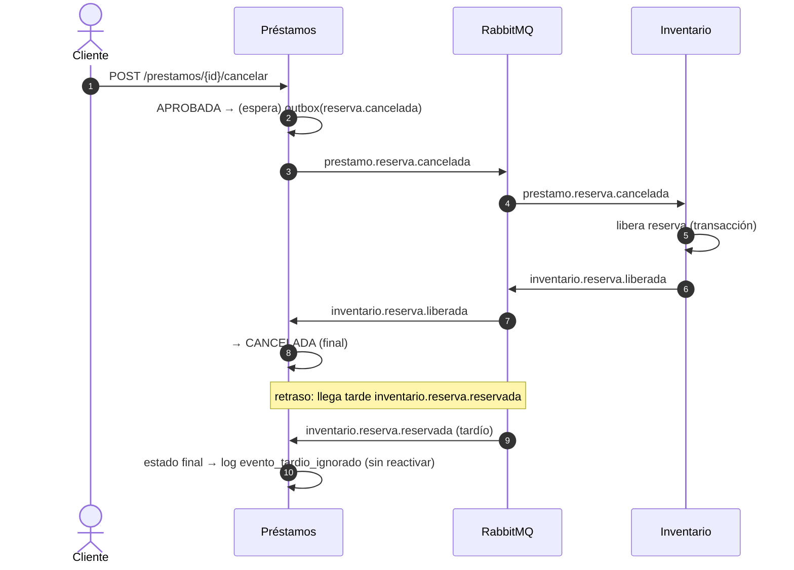
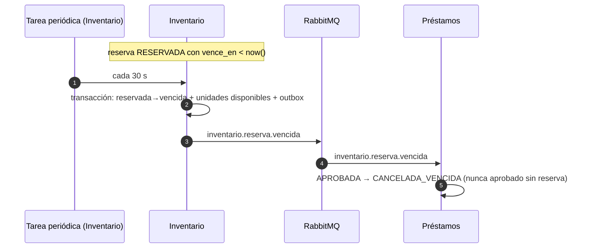

# Diagramas de arquitectura y secuencia

Diseño de P2-1.9. Se versionan como Mermaid (se renderizan en GitHub y se actualizan con el
código).

## 1. Arquitectura general

```mermaid
flowchart TB
    subgraph Cliente
        NAV[Navegador · frontend React]
    end

    subgraph Servicios_de_negocio["Servicios de negocio (4)"]
        PROD[Productos :8001<br/>FastAPI · esquema productos]
        CLI[Clientes :8002<br/>FastAPI · esquema clientes<br/>auth + importación CSV]
        PRE[Préstamos :8003<br/>FastAPI · esquema prestamos<br/>modelo ML + MLflow client]
        INV[Inventario :8004<br/>FastAPI · esquema inventario]
    end

    subgraph Infraestructura
        PG[(PostgreSQL 17<br/>4 esquemas · 4 usuarios)]
        REDIS[(Redis 8<br/>solo Productos)]
        RABBIT[[RabbitMQ 4<br/>credimarket.topic + dlx]]
        MLFLOW[[MLflow Tracking<br/>volumen persistente]]
    end

    NAV -->|REST + JWT| PROD
    NAV -->|REST + JWT| CLI
    NAV -->|REST + JWT| PRE
    NAV -->|REST + JWT| INV

    PROD --- PG
    CLI --- PG
    PRE --- PG
    INV --- PG
    PROD <-->|cache-aside| REDIS

    PRE -->|comandos| RABBIT
    INV -->|eventos| RABBIT
    PRE <-->|tracking + artefactos| MLFLOW

    PRE -->|GET cliente (token servicio)| CLI
    PRE -->|GET cotización (token servicio)| PROD
```

Reglas visibles: el navegador toca solo APIs; ningún servicio cruza esquemas (las líneas `---` son
posesión individual del mismo motor); el broker solo conecta Préstamos↔Inventario; Redis solo vive
en Productos; MLflow es infraestructura consumida por Préstamos y por el proceso de entrenamiento
fuera de línea.

## 2. Secuencia · caso feliz (solicitud → reserva → aprobación → entrega)



## 3. Secuencia · rechazo por riesgo (sin inventario)



## 4. Secuencia · cancelación con evento tardío (prueba #7)



## 5. Secuencia · vencimiento de reserva (§4)


