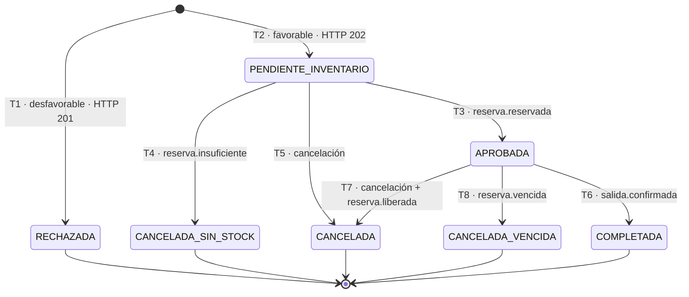

# Máquina de estados del préstamo

Diseño de P2-1.6 y P2-1.7. Base: §4 (tabla de estados mínimos + párrafos de vencimiento y eventos
tardíos) y §12 (pruebas 1, 3, 4, 7, 15).

## 1. Estados

Los 6 estados de la tabla mínima de §4, más un estado propio para el vencimiento (§4 permite que el
equipo defina el nombre del estado o motivo).

| Estado | Significado | Final |
|---|---|---|
| `PENDIENTE_INVENTARIO` | Riesgo favorable; `prestamo.reserva.solicitada` publicado; se respondió 202 | no |
| `RECHAZADA` | Modelo o reglas desfavorables; nunca se pidió inventario | **sí** |
| `APROBADA` | Inventario confirmó la reserva | no |
| `CANCELADA_SIN_STOCK` | Inventario respondió `insuficiente` | **sí** |
| `CANCELADA` | Cancelación previa a la entrega con reserva resuelta (liberada o inexistente) | **sí** |
| `CANCELADA_VENCIDA` | La reserva venció; Inventario la liberó y publicó `vencida` | **sí** |
| `COMPLETADA` | Inventario confirmó la salida (entrega simulada) | **sí** |

Notas de diseño:
- `CANCELADA_VENCIDA` es el "estado o motivo" que §4 pide definir para el vencimiento. Un préstamo
  `APROBADA` **nunca** puede quedarse con reserva inexistente: la única salida de `APROBADA` sin
  entrega es vía liberación → `CANCELADA` o vencimiento → `CANCELADA_VENCIDA`.
- No existe estado de "reactivación": los estados finales son absorbentes (prueba #7).

## 2. Transiciones (origen → destino · disparador · efectos)

| # | Origen | Destino | Disparador | Efectos |
|---|---|---|---|---|
| T1 | — (POST /prestamos) | `RECHAZADA` | inferencia/reglas desfavorables | guarda `modelo_version`, `umbral`, `probabilidad`, `motivo`; **no** publica nada a Inventario; responde 201 |
| T2 | — (POST /prestamos) | `PENDIENTE_INVENTARIO` | inferencia/reglas favorables | persiste préstamo + outbox `reserva.solicitada` en **una transacción**; responde **202** |
| T3 | `PENDIENTE_INVENTARIO` | `APROBADA` | evento `inventario.reserva.reservada` | guarda `reserva_id`; commit **después** ack |
| T4 | `PENDIENTE_INVENTARIO` | `CANCELADA_SIN_STOCK` | evento `inventario.reserva.insuficiente` | guarda motivo; commit **después** ack |
| T5 | `PENDIENTE_INVENTARIO` | `CANCELADA` | cancelación del usuario/admin (o `liberada` tardía de reserva ya inexistente) | outbox `reserva.cancelada`; si no había reserva creada, termina al confirmar que no hay reserva pendiente |
| T6 | `APROBADA` | `COMPLETADA` | evento `inventario.salida.confirmada` | guarda `entregado_en` |
| T7 | `APROBADA` | `CANCELADA` | cancelación del usuario/admin + confirmación `reserva.liberada` | **solo termina en `CANCELADA` tras recibir `liberada`** (§4) |
| T8 | `APROBADA` | `CANCELADA_VENCIDA` | evento `inventario.reserva.vencida` | registra vencimiento; la reserva ya no existe en Inventario |
| T9 | cualquiera final | *(sin cambio)* | evento tardío (`reservada`, `liberada`, `vencida`, `salida.confirmada`) | **no reactiva**; se registra en log con `correlation_id` como `evento_tardio_ignorado` |

Salidas por estado final: ninguna (absorbentes).

## 3. Diagrama (Mermaid)

## 4. Tiempos de espera (§4: documentar)

| Parámetro | Valor | Comportamiento |
|---|---|---|
| `RESERVA_VENCIMIENTO` | 10 minutos | Inventario libera reservas no entregadas ni canceladas; publica `reserva.vencida` |
| `ESPERA_EVENTO_RESERVA` | 30 segundos | si `PENDIENTE_INVENTARIO` no recibe evento, el frontend hace polling y Préstamos expone el estado; el evento llegue tarde o no, el estado solo cambia por T3/T4/T5 |
| `ESPERA_EVENTO_LIBERACION` | 15 segundos | tras cancelar `APROBADA`, si no llega `liberada` se reintenta publicación vía outbox (no se marca `CANCELADA` antes) |
| Reintentos broker | 3 intentos, TTL 5 s | después → dead letter |

Los valores se configuran por variables de entorno (`RESERVA_VENCIMIENTO_SEG`, etc.).

## 5. Reservas, vencimiento, cancelaciones y eventos tardíos (P2-1.7)

- **Reserva atómica:** `UPDATE inventario.existencia SET reservada = reservada + :n
  WHERE producto_id = :p AND (total - reservada) >= :n` → filas afectadas 0 ⇒ `insuficiente`
  (nunca existencias negativas; pruebas #3 y #4).
- **Vencimiento:** tarea periódica en Inventario (cada 30 s) busca reservas `RESERVADA` con
  `vence_en < now()`, las pasa a `VENCIDA` en la misma transacción que devuelve las unidades a
  disponibles y escribe outbox `reserva.vencida`. Préstamos recibe T8.
- **Cancelación previa a la entrega:** T5/T7. Con reserva → broker `reserva.cancelada` → Inventario
  libera atómicamente → `reserva.liberada` → recién entonces `CANCELADA` (commit local + ack).
- **Eventos tardíos (prueba #7):** T9 es absorbente. Casos cubiertos: `reservada` tras `CANCELADA`;
  `salida.confirmada` tras cancelación; `vencida` tras `liberada`. En todos: sin cambio de estado,
  log `evento_tardio_ignorado{prestamo_id, type, event_id}`.
- **Carrera cancelación vs entrega:** si Inventario ya confirmó salida (`salida.confirmada` en
  vuelo) y llega `reserva.cancelada`, Inventario resuelve por orden de llegada: salida confirmada
  primero ⇒ la cancelación no libera (reserva ya consumida) ⇒ Préstamos ignora `liberada` si llega
  sin reserva; si la cancelación llega primero ⇒ salida se rechaza con `409` en el endpoint de
  entrega. Ambos órdenes terminan en un único estado final coherente.
- **Carrera dos solicitudes por la última unidad (prueba #4):** la condición `WHERE` atómica deja
  pasar exactamente una; la otra recibe `insuficiente` ⇒ `CANCELADA_SIN_STOCK`.

## 6. Reglas críticas cubiertas

| Regla (prompt) | Dónde |
|---|---|
| Riesgo favorable ≠ aprobado | T2/T3 separan `PENDIENTE_INVENTARIO` de `APROBADA` |
| Aprobación solo con reserva confirmada | T3 es la única vía a `APROBADA` |
| Evento tardío no reactiva | T9 |
| Cancelación final exige resolver reserva | T7 espera `liberada` |
| Vencimiento no deja aprobado con reserva inexistente | T8 única salida no-entrega de `APROBADA` |
| Rechazo no pide inventario | T1 sin outbox a Inventario |
